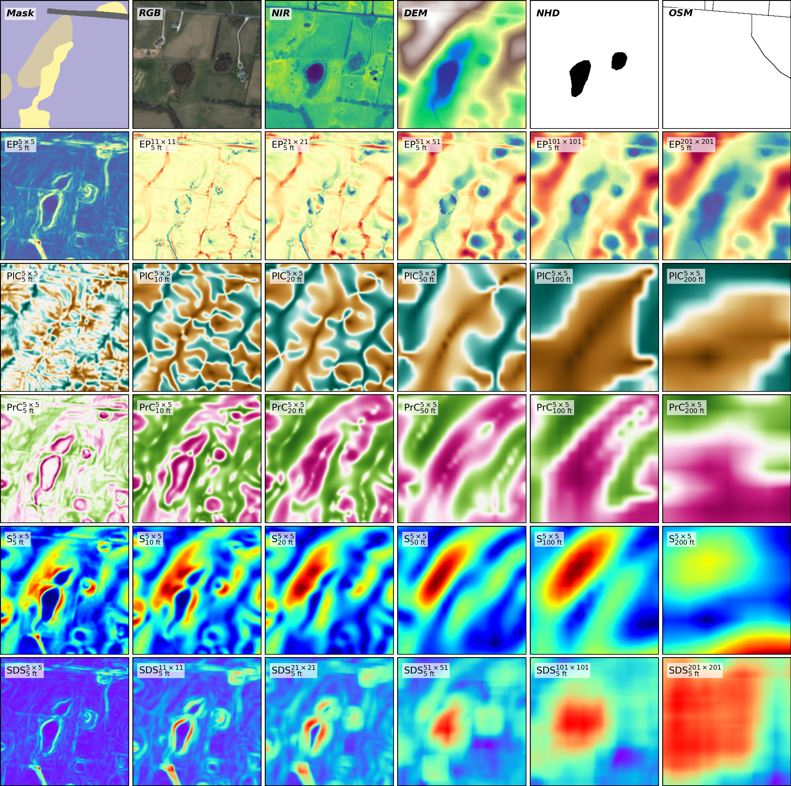
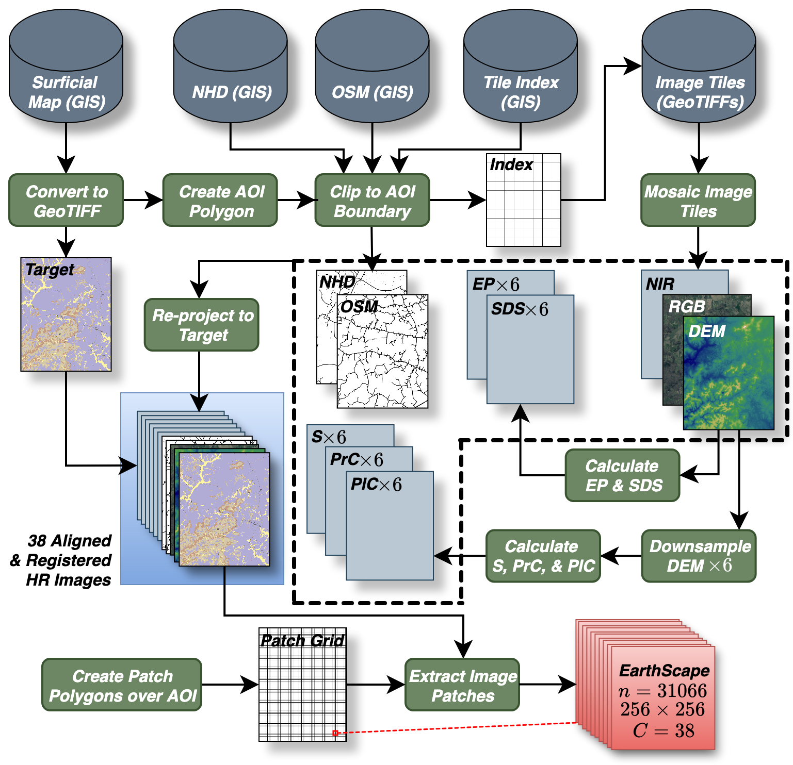
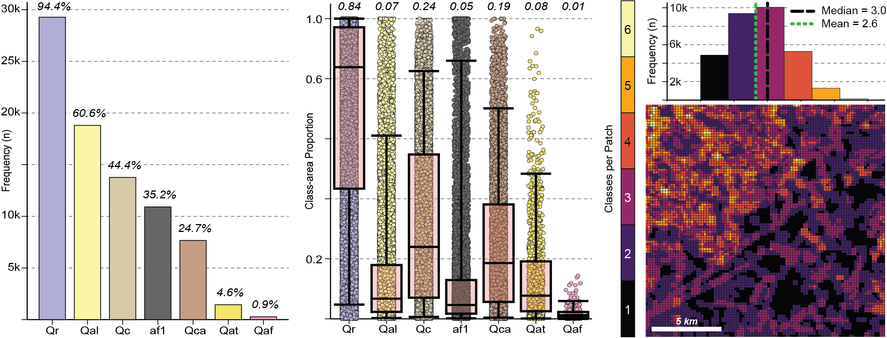

# EarthScape: A Multimodal Dataset and Benchmark for Surficial Geologic Mapping and Earth Surface Analysis

<p align="center">

</p>

# Table of Contents
1. [Introduction](#introduction)
2. [Updates](#updates)
3. [Installation](#installation)
4. [Model Training and Inference](#experiments)
5. [Navigating the Repository](#navigating-the-repository)
6. [Exploring the Dataset](#exploring-the-dataset)
7. [Baseline Benchmarks](#baseline-benchmarks)
8. [Roadmap](#roadmap)
9. [Citations](#cite)

# Introduction
[](#)
[](#)
[](https://doi.org/10.13023/kgs.data.05.01.2025)
[](https://doi.org/10.48550/arXiv.2503.15625)
[](https://opensource.org/licenses/MIT)

EarthScape is an open-source, AI-ready geospatial dataset for surficial geologic mapping and Earth surface analysis. It is designed to support multimodal learning, multi-scale reasoning, and geographic domain shift evaluation.

The dataset includes masks/labels and 37 predictive input features...
- Expert-labeled surficial geologic masks and vector labels
- LiDAR-derived DEMs and geomorphometric terrain features at multiple spatial resolutions  
- Aerial RGB+NIR imagery  
- Hydrography and infrastructure vector layers  

We have published benchmarks for...
- Multilabel classification
- Semantic segmentation
- Geographic domain shift using disjoint regions within a shared label space
- Model and multimodal fusion performance as functions of dataset characteristics


# Updates
1. Codebase v1.1.1 has been updated and extended. (November 2026)
2. Dataset v1.1 is now available! (April 2026)
    - Same as v1.0, but with several updates...
      - Profile and planform curvatures are now consistent across all subsets
      - Categorical and binary image features are supplied as `uint8` instead of `float32`


# Installation

1. Clone the repository.
2. Install [Conda](https://anaconda.org/channels/anaconda/packages/conda/overview) or [Miniconda](https://www.anaconda.com/docs/getting-started/miniconda/main).
3. Create the environment. If using non-GPU machine, delete 'pytorch-gpu' from [`environment.yml`]().
    ```Bash
    conda env create -f environment.yml
    ```
4. Activate the environment.
    ```Bash
    conda activate earthscape
    ```
5. Install the earthscape package.
    ```Bash
    pip install -e .
    ```
6. You can now use EarthScape to reproduce the dataset, train and evaluate models, and run analyses. While the full data pipeline is available, most users will prefer downloading the precompiled dataset.
    1. [Download the dataset and metadata files.](https://uknowledge.uky.edu/kgs_data/16/)
    2. Extract all archives into the [`data/`](https://github.com/masseygeo/earthscape/tree/v1.1/data) directory.

# Model Training and Inference

Once the repository is cloned and the dataset is added, you are ready to run experiments. This codebase comes with several models ready to try, but you can also adapt your own.

## Run a single experiment

1. Modify [`configs_template.yml`](https://github.com/masseygeo/earthscape/blob/v1.1/configs_template.yml) file for your experiment.
    - Most settings can also be overridden via CLI flags.
    - A copy of the configs file will be saved in your experiment output folder for reproducibility.

2. Run the training script.
    - Multilabel classification...

      ```
      train_cls --config_path configs_template.yml --mode train-test-cross
      ```
      
    - Semantic segmentation...

      ```
      train_seg --config_path earthscape/configs_template.yml --mode train-test-cross
      ```

3. Explore training logs and performance metrics for the experiment.
    - Experiment output folders are named systematically as `{model}_{modality}_{timestamp}` by default

## Run multiple experiments

1. Define your sweep (inputs, models, hyperparameters) in the classification [`run_cls.py`](https://github.com/masseygeo/earthscape/blob/v1.1/scripts/run_cls.py) or segmentation [`run_seg.py`](https://github.com/masseygeo/earthscape/blob/v1.1/scripts/run_seg.py) script.

2. Run the script from the command line.
    - Multilabel Classification
      ```
      python scripts/run_cls.py
      ```
      
    - Semantic Segmentation

        ```
        python scripts/run_seg.py
        ```
        
3. Explore training logs and performance metrics for the experiment.
    - Experiment output folders are named systematically as `{model}_{modality}_{timestamp}` by default


# Navigating the Repository
- :file_folder: [`assets/`](https://github.com/masseygeo/earthscape/tree/main/assets) - Figures and tables from dataset and experiment analyses.
- :file_folder: [`data/`](https://github.com/masseygeo/earthscape/tree/main/data) - Dataset and associated metadata.)
- :file_folder: [`earthscape/`](https://github.com/masseygeo/earthscape/tree/main/earthscape) - Source code.
- :file_folder: [`experiments/`](https://github.com/masseygeo/earthscape/tree/main/experiments) - Multilabel classification and segmentation experiments.
- :file_folder: [`notebooks/`](https://github.com/masseygeo/earthscape/tree/main/notebooks) - Jupyter notebooks for dataset generation, statistics, splits, and analysis.
- :file_folder: [`scripts/`](https://github.com/masseygeo/earthscape/tree/main/scripts) - Experiment orchestration scripts for bulk hyperparameter sweeps.
- :file_folder: [`splits/`](https://github.com/masseygeo/earthscape/tree/main/splits) - Train, validation, in-domain, and cross-domain test splits.
- :page_facing_up: [`CHANGELOG.md`](https://github.com/masseygeo/earthscape/blob/v1.1/CHANGELOG.md) - Version history.
- :page_facing_up: [`configs_template.yml`](https://github.com/masseygeo/earthscape/blob/v1.1/configs_template.yml) - Experiment configuration file to be modified by the user (a copy will be saved with each experiment).
- :page_facing_up: [`environment.yml`](https://github.com/masseygeo/earthscape/blob/v1.1/environment.yml) - Reproducible environment specification.
- :page_facing_up: [`pyproject.toml`](https://github.com/masseygeo/earthscape/blob/v1.1/pyproject.toml) - Python package configuration.


# Exploring the Dataset
[](#)
[](#)
[](#)
[](#)
[](#)
[](#)

## What's included?
### Image Patches
- Segmentation masks
- Aerial optical imagery (RGB+NIR)
- LiDAR DEM
- OpenStreetMap road and railway centerlines
- U.S. Geological Survey National Hydrography Dataset stream flowlines and water body polygons
- DEM-derived terrain features calculated at six spatial resolutions:
    - Elevation Percentile
    - Planform Curvature
    - Profile Curvature
    - Slope
    - Standard Deviation of Slope
- Small example smokeset
- Filenames that use a unique patch ID and modality/scale: `*{patch_id}_{modality/scale}.tif*`

### Metadata Files
- [areas.csv](https://github.com/masseygeo/earthscape/blob/v1.1/data/esv1p1_areas.csv) - Per-patch class area proportions.
- [labels.csv](https://github.com/masseygeo/earthscape/blob/v1.1/data/esv1p1_labels.csv) - Binary class presence labels (≥1 pixel).
- [patches.geojson](https://github.com/masseygeo/earthscape/blob/v1.1/data/esv1p1_patches.geojson) - Patch geometries.
- [metadata.json](https://github.com/masseygeo/earthscape/blob/v1.1/data/esv1p1_metadata.json) - Dataset-level metadata.
- [stats.csv](https://github.com/masseygeo/earthscape/blob/v1.1/data/esv1p1_stats.csv) - Per-modality summary statistics.
- Common keys (*patch_id*, *modality*) enable joins across files and data layers.


## Dataset Governance and Versioning
### Major releases (vX.0.0)
- Introduce substantial changes to dataset scope  
- May include new geographic regions, label space or classes, tasks (e.g., additional prediction objectives), or significant additions to input modalities or features  
- Train/validation/test splits may be redefined for each major release

### Minor releases (vX.Y.0)
- Update dataset content within the existing scope  
- May include improved or corrected data processing workflows, updated or refined input features, or additional benchmarks or tasks within the same label space  
- Train/validation/test splits remain fixed

### Patch releases (vX.Y.Z)
- Do not modify dataset content  
- May include code updates or restructuring, documentation improvements, additional analyses or experiment configurations, or bug fixes and usability enhancements  

### Versioning
- The [downloadable dataset](https://uknowledge.uky.edu/kgs_data/16/) corresponds to the latest major or minor version (e.g., v1.0, v1.1, v2.0)
- The GitHub repository reflects the corresponding dataset version, along with any subsequent patch-level updates
- Version changes will be documented in [`CHANGELOG.md`](https://github.com/masseygeo/earthscape/blob/v1.1/CHANGELOG.md)


## Dataset Preparation
EarthScape is derived from open-access geospatial data sources, compiled into a co-registered stack at a native resolution of 5 ft (~1.5 m) GSD. Terrain features are computed across multiple spatial scales. Slope and curvatures are calculated using 5x5 windows on DEMs resampled to 5, 10, 20, 50, 100, and 200 ft resolutions. Elevation percentile and slope standard deviation are computed from only the 5 ft DEM using variable kernel sizes (5x5, 11x11, 21x21, 51x51, 101x101, 201x201) to ensure a consistent effective spatial footprint across features. Patches are generated within mapped surficial geologic extents, ensuring no background or nodata regions. All layers are validated for spatial alignment and co-registration prior to patch extraction. Final patches are clipped to a common extent and verified for consistent resolution and dimensions.

<p align="center">

</p>

Check out these notebooks to see how each map area and the smokeset were compiled and processed...
- [Hardin County, Howe Valley Quadrangle](https://github.com/masseygeo/earthscape/blob/v1.1/notebooks/data_hardin_howevalley.ipynb)
- [Hardin County, Sonora Quadrangle](https://github.com/masseygeo/earthscape/blob/v1.1/notebooks/data_hardin_sonora.ipynb)
- [Warren County quadrangles](https://github.com/masseygeo/earthscape/blob/v1.1/notebooks/data_warren.ipynb)
- [Smokeset](https://github.com/masseygeo/earthscape/blob/v1.1/notebooks/data_smokeset.ipynb)


## Class Labels
EarthScape defines seven surficial geologic units that form a mutually exclusive representation of surface cover within each study area. These units correspond to distinct surficial geologic processes that are broadly applicable across many landscapes:
- Fluvial deposits — Qal (alluvium), Qat (terrace deposits)
- Debris-flow deposits — Qaf (alluvial fans)
- Hillslope materials — Qc (colluvium), Qca (colluvial aprons)
- In-situ weathering — Qr (residuum)
- Anthropogenic modification — af1 (artificial fill)


## Dataset Characteristics
- Severe class imbalance and long-tailed distribution.
- Class frequencies span more than two orders of magnitude, with dominant units (e.g., Qr) present in most patches and rare units (e.g., Qaf, Qat) appearing infrequently.
- Inter-patch spatial structure and class co-occurrence.
- Class presence, frequency, and combinations vary systematically across geographic regions, reflecting spatial autocorrelation and non-random class co-occurrence patterns.
- Intra-patch complexity (multilabel structure) where each patch may contain between 1 and 6 classes, with highly variable spatial footprints and irregular geometries.
- Geographic domain shift (covariate shift) where disjoint regions share the same label space, but differ in input feature distributions.

<p align="center">

</p>

See the following notebook for more in-depth analysis of the dataset...
- [EarthScape Exploratory Data Analysis (EDA)](https://github.com/masseygeo/earthscape/blob/v1.1/notebooks/data_eda.ipynb)


# Baseline Benchmarks
EarthScape includes reproducible baseline experiments designed to evaluate modality contributions, multi-scale representations, and cross-domain generalization.

## Multilabel classification
- Models
    - ResNet18, ResNet50, ViT-B/16, Swin-Tiny
    - No pre-trained weights
- Input Configurations
    - All single modalities
    - Multi-scale stacks of terrain features
    - Select multimodal combinations
- Training
    - Binary cross entropy 
    - AdamW optimizer
    - Learning rate scheduler (linear warmup followed by cosine decay)
    - Early stopping with patience of 10 epochs 
- Evaluation
    - Spatially-independent in-domain train/val/test splits
    - In-domain & cross-domain testing
    - Overall model & class-wise performance metrics
        - Precision, recall, F1, AUROC, mAP/AP
- *All experiment configuration files (configs.yml) can be found in the respective directories [here](https://github.com/masseygeo/earthscape/tree/v1.1/experiments/baselines/classification).*

## Semantic segmentation
- Models
    - U-Net (ResNet18), DeepLabv3+ (ResNet50), Segformer (MiT-b0)
    - No pre-trained weights
- Input Configurations
    - Select single modalities
    - Multi-scale stacks of terrain features
    - Select multimodal combinations
- Training
    - Cross entropy 
    - AdamW optimizer
    - Learning rate scheduler (linear warmup followed by cosine decay)
    - Early stopping with patience of 10 epochs
- Evaluation
    - Spatially-independent in-domain train/val/test splits
    - In-domain & cross-domain testing
    - Overall model, overall class-wise, & image-level performance metrics
        - IoU, Dice Score, Hausdorff Distance
- *All experiment configuration files (configs.yml) can be found in the respective directories [here](https://github.com/masseygeo/earthscape/tree/v1.1/experiments/baselines/segmentation).*

      
## Key findings
- **Multi-scale representations improve robustness.** Stacking terrain features across spatial scales consistently improves stability and cross-domain performance compared to single-scale inputs.
- **Raw elevation and imagery are brittle under domain shift.** DEM and RGB often perform well in-domain but degrade substantially in cross-domain settings, reflecting sensitivity to regional differences in absolute elevation and appearance.
- **More modalities do not reliably improve performance.** Adding additional inputs does not consistently yield gains and can introduce redundancy or noise, sometimes degrading performance.
- **Model architecture influences performance and generalization.** Smaller models (ResNet-18, Swin-Tiny) outperform larger models (ResNet-50, ViT) for multilabel classification, while transformer-based models (SegFormer) outperform CNN-based models for segmentation.
- **Class imbalance significantly impacts performance.** Rare classes are consistently harder to predict across models and input configurations.
- **Domain shift remains a central challenge.** All models exhibit performance degradation when evaluated on geographically disjoint regions, highlighting the difficulty of transferring learned representations across landscapes. Modality selection plays a significant role in reducing model transfer failures.

Check out these notebooks for more information and visualizations...
- [Training, Validation, and Testing Splits](https://github.com/masseygeo/earthscape/blob/v1.1/notebooks/splits.ipynb)
- [Classification](https://github.com/masseygeo/earthscape/blob/v1.1/notebooks/analysis_cls.ipynb)
- [Segmentation](https://github.com/masseygeo/earthscape/blob/v1.1/notebooks/analysis_seg.ipynb)


# Roadmap
### Expanded Data Sources
- Integration of national-scale datasets (USGS 3DEP DEM, NAIP RGB+NIR)
- Additional terrain features (e.g., topographic position index)
- Improved feature representations (e.g., logarithmic scaling)

### Geographic Expansion
- Addition of new regions with shared label space to enable broader domain shift studies
- Inclusion of new geologic tasks for improved generalization benchmarking

### Benchmark Development
- Expanded baseline experiments across additional modalities and model architectures
- Systematic evaluation of cross-domain generalization and modality transferability

### Modeling and Methods
- Exploration of multimodal fusion strategies (early fusion, attention-based methods)
- Integration of foundation models and pretraining approaches
- Investigation of domain adaptation and generalization techniques
- Model development and testing to handle challenges of EarthScape

### Code and Usability
- Standardized evaluation scripts and reporting tools
- Improved experiment configuration and orchestration workflows
- Enhanced dataset indexing and geospatial query capabilities

## Roadmap
- Expanding the dataset with new surficial geologic maps
- Updating the unique patch ID grid for intuitive geospatially aware selection
- Testing datasets with broader coverage (e.g., 1/3-arc-second DEM, ASTER DEM, etc.)
- Segmentation benchmarks


## Contributing to EarthScape
We encourage your contributions to EarthScape! Detailed instructions to come...


# Cite
```
# dataset
@misc{massey2025earthscape_dataset,
    title        = {EarthScape AI Dataset},
    author       = {Massey, Matthew and Imran, Abdullah-Al-Zubaer},
    year         = {2025},
    institution  = {Kentucky Geological Survey, University of Kentucky},
    series       = {Research Data},
    publisher    = {University of Kentucky Libraries},
    doi          = {10.13023/kgs.data.05.01.2025},
    url          = {https://doi.org/10.13023/kgs.data.05.01.2025},
    note         = {Version 1.1}
}
    
# manuscript
@article{massey2026earthscape,
    title   = {EarthScape: A Multimodal Dataset for Surficial Geologic Mapping and Earth Surface Analysis},
    author  = {Massey, Matthew and Munia, Nusrat and Imran, Abdullah-Al-Zubaer},
    year    = {2026},
    journal = {arXiv preprint arXiv:2503.15625},
    doi     = {10.48550/arXiv.2503.15625},
    url     = {https://doi.org/10.48550/arXiv.2503.15625}
}
```
