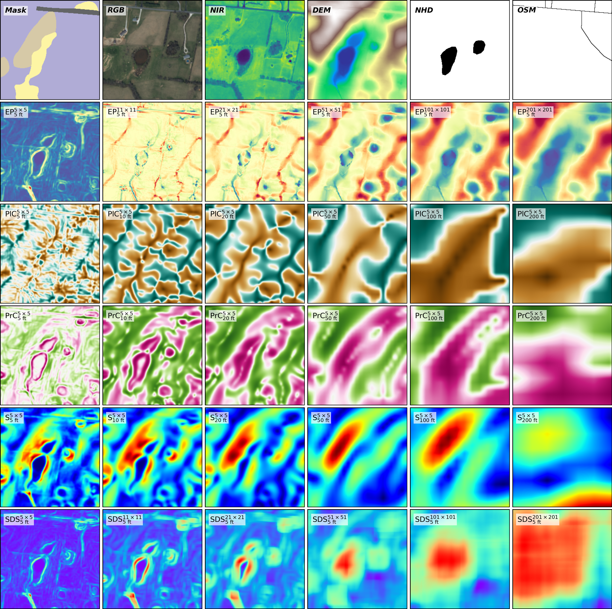
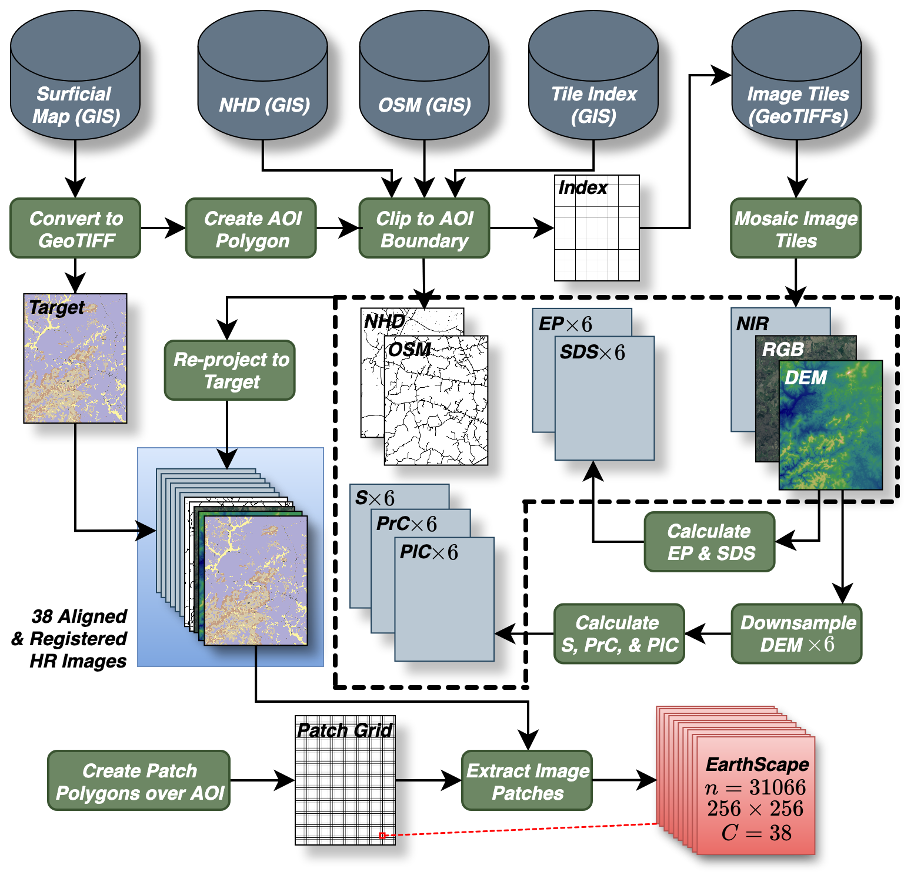
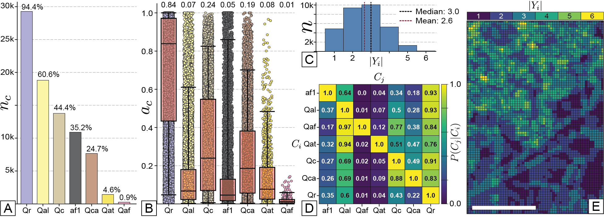

# EarthScape: A Multimodal Dataset and Benchmark for Surficial Geologic Mapping and Earth Surface Analysis

<p align="center">

</p>


# Introduction
[](#)
[](#)
[](https://opensource.org/licenses/MIT)

[](https://doi.org/10.13023/kgs.data.05.01.2025)
[](https://doi.org/10.48550/arXiv.2503.15625)

EarthScape is an open-source, AI-ready geospatial dataset for surficial geologic mapping and Earth surface analysis. It is designed to support multimodal learning, multi-scale reasoning, and geographic domain shift evaluation.

The dataset includes masks/labels and 37 predictive input features...
- Expert-labeled surficial geologic masks and vector labels
- LiDAR-derived DEMs and geomorphometric terrain features at multiple spatial resolutions  
- Aerial RGB+NIR imagery  
- Hydrography and infrastructure vector layers  

We have published benchmarks for...
- Multilabel classification
- Semantic segmentation
- Geographic domain shift using disjoint regions within a shared label space
- Model and multimodal fusion performance as functions of dataset characteristics


# Table of Contents
1. [Updates](#updates)
2. [Navigating the Repository](#navigating-the-repository)
3. [Installation](#installation)
4. [Model Training and Inference](#model-training-and-inference)
5. [Exploring the Dataset](#exploring-the-dataset)
6. [Benchmarks](#benchmarks)
7. [Roadmap](#roadmap)
8. [Contributions](#contributions)
9. [Citations](#cite)


# Updates
- **November 2026:** Codebase v1.1.1 has been updated and extended.
    - SGMap-Net model with experiments
- **April 2026:** Dataset v1.1 and codebase v1.1.0 are now available!
    - Profile and planform curvatures are now consistent across all subsets
    - Categorical and binary image features are supplied as `uint8` instead of `float32`
    - Baseline model experiments


# Navigating the Repository
- :file_folder: [`assets/`](assets) - Figures and tables from dataset and experiment analyses.
- :file_folder: [`data/`](data) - Dataset images and metadata.
- :file_folder: [`earthscape/`](earthscape) - Source code.
- :file_folder: [`experiments/`](experiments) - Multilabel classification and segmentation experiments.
- :file_folder: [`notebooks/`](notebooks) - Jupyter notebooks for dataset generation, statistics, splits, and analysis.
- :file_folder: [`scripts/`](scripts) - Experiment orchestration scripts for bulk hyperparameter sweeps.
- :file_folder: [`splits/`](splits) - Train, validation, in-domain, and cross-domain test splits.
- :page_facing_up: [`CHANGELOG.md`](CHANGELOG.md) - Version history.
- :page_facing_up: [`configs_template.yml`](configs_template.yml) - Experiment configuration file to be modified by the user.
- :page_facing_up: [`environment.yml`](environment.yml) - Reproducible environment specification.
- :page_facing_up: [`pyproject.toml`](pyproject.toml) - Python package configuration.


# Installation

1. Clone the repository.
2. Install [Conda](https://anaconda.org/channels/anaconda/packages/conda/overview) or [Miniconda](https://www.anaconda.com/docs/getting-started/miniconda/main).
3. Create the environment. If using non-GPU machine, delete 'pytorch-gpu' from [`environment.yml`]().
    ```Bash
    conda env create -f environment.yml
    ```
4. Activate the environment.
    ```Bash
    conda activate earthscape
    ```
5. Install the EarthScape package.
    ```Bash
    pip install -e .
    ```
6. Install the precompiled dataset.
    1. Download the dataset and metadata files [here](https://doi.org/10.13023/kgs.data.05.01.2025).
    2. Extract all archives into the [`data/`](data) directory.
    - *Note: The dataset is also reproducible using the full pipeline.*


# Model Training and Inference

Once the repository is cloned and the dataset is added, you are ready to run experiments. This codebase comes with several models ready to try, but you can also adapt your own.

## Run a single experiment

1. Modify [`configs_template.yml`](https://github.com/masseygeo/earthscape/blob/v1.1/configs_template.yml) file for your experiment.
    - Most settings can also be overridden via CLI flags.
    - A copy of the configs file will be saved in your experiment output folder for reproducibility.

2. Run the training script.
    - Multilabel classification...

      ```
      train_cls --config_path configs_template.yml --mode train-test-cross
      ```
      
    - Semantic segmentation...

      ```
      train_seg --config_path earthscape/configs_template.yml --mode train-test-cross
      ```

3. Explore training logs and performance metrics for the experiment.
    - Experiment output folders are named systematically as `{model}_{modality}_{timestamp}`

## Run multiple experiments

1. Define your sweep (inputs, models, hyperparameters) in the classification [`run_cls.py`](https://github.com/masseygeo/earthscape/blob/v1.1/scripts/run_cls.py) or segmentation [`run_seg.py`](https://github.com/masseygeo/earthscape/blob/v1.1/scripts/run_seg.py) script.

2. Run the script from the command line.
    - Multilabel Classification
      ```
      python scripts/run_cls.py
      ```
      
    - Semantic Segmentation

        ```
        python scripts/run_seg.py
        ```
        
3. Explore training logs and performance metrics for the experiment.


# Exploring the Dataset
[](#)
[](#)
[](#)
[](#)
[](#)
[](#)

## What's included?
Each patch location represents a 256x256 area at 5 ft (~1.52 m) ground sampling distance with 38 channels. All images are in GeoTIFF format using the EPSG:3089 coordinate reference system. Images are single channel and use systematic filename conventions of `{patch_id)_{modality}_{scale, optional}.tif`
- Segmentation mask: `*_mask.tif`
- Aerial RGB+NIR optical imagery: `*_aerialr.tif`, `*_aerialg.tif`, `*_aerialb.tif`, `*_aerialnir.tif`
- LiDAR-derived DEM: `*_dem.tif`
- OpenStreetMap road and railway centerlines: `*_osm.tif`
- U.S. Geological Survey National Hydrography Dataset stream flowlines and water body polygons: `*_nhd.tif`
- Five terrain features are computed directly from the DEM at six spatial resolutions. Elevation Profile and Standard Deviation of Slope are calculated using variable windows with the original DEM, with the window size indicated in the filename. Planform Curvature, Profile Curvature, and Slope are computed by downsampling the original DEM to five additional resolutions, with the DEM resolution used indicated in the filename. Window sizes and DEM resolutions were selected so that each terrain feature has the same approximate spatial support.
    - Elevation Percentile: `*_ep_5x5.tif`, `*_ep_11x11.tif`, `*_ep_21x21.tif`, `*_ep_51x51.tif`, `*_ep_101x101.tif`, `*_ep_201x201.tif`
    - Standard Deviation of Slope: `*_sds_5x5.tif`, `*_sds_11x11.tif`, `*_sds_21x21.tif`, `*_sds_51x51.tif`, `*_sds_101x101.tif`, `*_sds_201x201.tif`
    - Planform Curvature: `*_plc.tif`, `*_plc_10.tif`, `*_plc_20.tif`, `*_plc_50.tif`, `*_plc_100.tif`, `*_plc_200.tif`
    - Profile Curvature: `*_prc.tif`, `*_prc_10.tif`, `*_prc_20.tif`, `*_prc_50.tif`, `*_prc_100.tif`, `*_prc_200.tif`
    - Slope: `*_s.tif`, `*_s_10.tif`, `*_s_20.tif`, `*_s_50.tif`, `*_s_100.tif`, `*_s_200.tif`


Additional data is included in `*.csv`, `*.geojson`, and `*.json` files found in the [`data/`](data) and [`splits/`](splits) directories.
- `*areas.csv` - Provides per-patch class area proportions, which can be used to construct vector labels or guide learning objectives.
- `*labels.csv` - Binary class presence labels are simple one-hot encodings based on per-patch area proportions >0.0.
- `*patches.geojson` - Spatial geometries of patch locations, which can be visualized with GIS software.
- `*metadata.json` - Dataset-level metadata collected during dataset construction.
- `*stats.csv` - Per-modality summary statistics.
- Metadata attribute keys (`patch_id`, `modality`) enable joins across files and data layers.

## Dataset Preparation
<p align="center">

</p>

EarthScape is derived from open-access geospatial data sources, compiled into a co-registered stack at a native resolution of 5 ft (~1.52 m) GSD. Patches are generated within mapped surficial geologic extents, ensuring no background or nodata regions. All layers are validated for spatial alignment and co-registration prior to patch extraction. Final patches are clipped to a common extent and verified for consistent resolution and dimensions.

Check out these notebooks to see how each map area were compiled and processed...
- [Hardin County, Howe Valley Quadrangle](notebooks/data_hardin_howevalley.ipynb)
- [Hardin County, Sonora Quadrangle](notebooks/data_hardin_sonora.ipynb)
- [Warren County quadrangles](notebooks/data_warren.ipynb)
- [Training, Validation, and Testing Splits](notebooks/splits.ipynb)

## Class Labels
EarthScape defines seven surficial geologic units that form a mutually exclusive representation of surface cover within each study area. Geologic map unit classes correspond to distinct surficial geologic processes that are broadly applicable across many landscapes:

- Fluvial deposits — Qal (alluvium), Qat (terrace deposits)
- Debris-flow deposits — Qaf (alluvial fans)
- Hillslope materials — Qc (colluvium), Qca (colluvial aprons)
- In-situ weathering — Qr (residuum)
- Anthropogenic modification — af1 (artificial fill)

It's important to note that the label space remains fixed across EarthScape, which allows isolation of model, fusion, or shift effects. 

## Dataset Characteristics
<p align="center">

</p>

- Label imbalance and long-tailed distribution.
    - Class frequencies span more than two orders of magnitude
- Intra-patch complexity 
    - Label cardinality varies between 1 and 6 classes, with highly variable spatial supports.
- Inter-patch spatial structure and class co-occurrence.
    - Class presence and frequency vary systematically across geographic regions, reflecting spatial autocorrelation and non-random class co-occurrence patterns.
    - Maximum mean discrepancy shows that input feature distributions shift across region, ranging from 0.007 for planform curvature (200 ft GSD) to 0.273 for raw DEM (5 ft GSD)

See the following notebook for more in-depth analysis of the dataset...
- [EarthScape Exploratory Data Analysis (EDA)](notebooks/data_eda.ipynb)


## Dataset Governance and Versioning
Major releases (vX.0.0) introduce substantial changes to dataset scope, including new geographic regions, label space or classes, tasks, or significant additions to input modalities or features. Train/validation/test splits may be redefined for each major release.

Minor releases (vX.Y.0) update dataset content within the existing scope. This may include improved or corrected data processing workflows, updated or refined input features, or additional benchmarks or tasks. Train/validation/test splits remain fixed.

Patch releases (vX.Y.Z) do not modify dataset scope or content. These changes may include code updates or restructuring, documentation improvements, additional analyses or experiment configurations, or bug fixes and usability enhancements.

Versioning reflects the current dataset version and the codebase. The published dataset download corresponds to the latest major/minor version. The GitHub repository reflects the corresponding dataset version (major/minor), along with any subsequent patch-level updates. All version changes are documented in [`CHANGELOG.md`](CHANGELOG.md)


# Benchmarks
EarthScape includes reproducible baseline experiments designed to evaluate modality contributions, multi-scale representations, and cross-domain generalization.

## Baselines

Baseline models were evaluated across 45 unimodal, multi-scale, and multimodal input configurations using spatially independent in-domain (Warren County) and cross-domain (Hardin County) test sets. The best-performing configurations were repeated across five independent training runs.

- Multilabel classification: ResNet-18, ResNet-50, Swin Transformer (Tiny), and ViT-B/16
- Semantic segmentation: U-Net (ResNet-18), DeepLabV3+ (ResNet-50), and SegFormer (MiT-B0 & MiT-B2)
- All models were trained from scratch using binary cross-entropy, AdamW, a learning rate of 3x10<sup>-4</sup>, batch size of 64, and a maximum of 150 epochs, with learning-rate warmup, cosine decay, and early stopping.
- All experiments can be reproduced using the relevant `config.yml` file found in [`experiments/baselines`](experiments/baselines)

## SGMap-Net

SGMap-Net is a modular benchmark model designed to evaluate terrain representations, spatial scale, and multimodal fusion under geographic domain shift. Experiments compared 35 single-input and 15 multi-scale/multimodal configurations using in-domain (Warren County) and cross-domain (Hardin County) test sets, with additional training-seed and data-split sensitivity analyses.

- Multilabel classification: SGMap-Net with ResNeXt-50 and ViT-B/16 encoders.
- Semantic segmentation: DeepLabV3+ (ResNeXt-50) and SegFormer (MiT-B2).
- All models were trained using inputs adapted to three channels using 1x1 convolutions, ImageNet-pretrained encoders, AdamW, a learning rate of 3×10<sup>-4</sup>, batch size 16, five-epoch linear warmup, focal loss (classification) or cross-entropy (segmentation), and early stopping.
- Multi-scale and multimodal performance were compared using early channel stacking, mid-level feature concatenation, and cross-attention fusion methods; self-attention was also considered for single-modality inputs.

## Foundation Models
Five geospatial foundation models (Copernicus-FM, DOFA, Galileo, Panopticon, and TerraMind) were evaluated using compatible EarthScape modalities and spatially independent in-domain and cross-domain test sets. Models were fully fine-tuned using their native modality handling, with learning-rate sweeps to select the best configuration.
    
## Key findings
- Terrain representation and spatial scale influence robustness. Engineered terrain features generally transfer more effectively than raw elevation, while multi-scale and complementary terrain representations provide the strongest overall performance.
- Raw sensor inputs exhibit substantial geographic degradation. DEM achieves strong in-domain performance but transfers less effectively than engineered terrain representations, while optical imagery provides limited additional benefit.
- More modalities do not guarantee better performance. Combining inputs does not consistently improve results, emphasizing the importance of complementary information rather than modality count.
- Fusion effectiveness depends on architecture and domain. Cross-attention provides no systematic advantage over simpler stacking or concatenation, with performance varying across backbones and evaluation domains.
- Class imbalance remains a major challenge. Rare geologic classes exhibit poor cross-domain F1, although relatively high AUC in some configurations indicates retained discriminative ability.
- Geographic robustness is representation-dependent. Cross-domain performance degradation is associated with differences in input distributions, with the strength of this relationship varying by backbone and fusion strategy.

Check out these notebooks for more information and visualizations...
- [Classification](notebooks/analysis_cls.ipynb)
- [Segmentation](notebooks/analysis_seg.ipynb)


# Roadmap
- Data Source Expansion
    - Integration of national-scale datasets (USGS 3DEP DEM, NAIP RGB+NIR)
    - Additional terrain features (e.g., topographic position index)
- Geographic Expansion
    - Addition of new mapping within the same label space, which will triple the current size
- Code and Usability
    - Standardized evaluation scripts and reporting tools
    - Improved experiment configuration and orchestration workflows
    - Enhanced dataset indexing and geospatial query capabilities


# Contributions
We encourage your contributions to EarthScape! Detailed instructions to come, or contact us directly!


# Cite
```
# dataset
@misc{massey2025earthscape_dataset,
    title        = {EarthScape AI Dataset},
    author       = {Massey, Matthew and Imran, Abdullah-Al-Zubaer},
    year         = {2025},
    institution  = {Kentucky Geological Survey, University of Kentucky},
    series       = {Research Data},
    publisher    = {University of Kentucky Libraries},
    doi          = {10.13023/kgs.data.05.01.2025},
    url          = {https://doi.org/10.13023/kgs.data.05.01.2025},
    note         = {Version 1.1}
}
    
# SGMap-Net benchmark manuscript
@article{massey2026earthscape,
    title   = {EarthScape: A Multimodal Dataset for Surficial Geologic Mapping and Earth Surface Analysis},
    author  = {Massey, Matthew and Munia, Nusrat and Imran, Abdullah-Al-Zubaer},
    year    = {2026},
    journal = {arXiv preprint arXiv:2503.15625},
    doi     = {10.48550/arXiv.2503.15625},
    url     = {https://doi.org/10.48550/arXiv.2503.15625}
}
```
